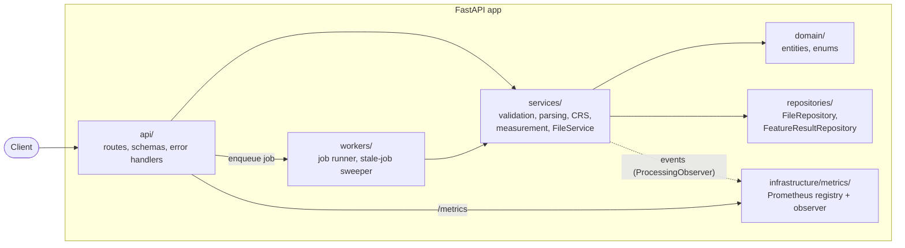
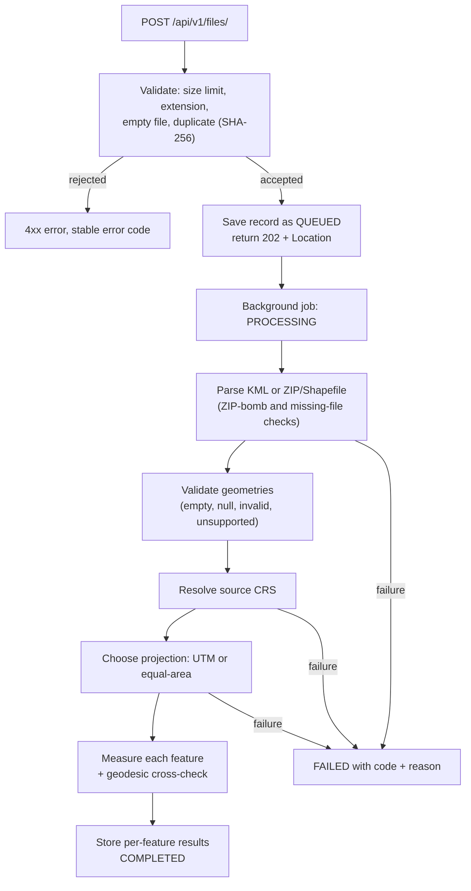

# Geospatial Processing Platform

A FastAPI service that accepts a KML file or a zipped Shapefile, extracts every feature, and returns **per-feature measurements** (area for polygons, length for lines) computed in a **suitable projected CRS**, never in raw latitude/longitude degrees.

Built as a hiring assignment (Geospatial File Measurement API), but structured as a small service that could grow: layered architecture, background jobs, structured logging, Prometheus metrics, a benchmark suite and 456 automated tests.

   

### At a glance

| | |
|---|---|
| **Tests** | **456 passing** (unit and integration) |
| **Throughput** | **~14,000 features/s** (median, synthetic polygons, pipeline only) |
| **100,000 features** | **7.0 s median**, **267 MB peak memory** |
| **Real-data check** | **177 / 177** Natural Earth countries measured, one real bug found and fixed |
| **CRS accuracy** | Geodesic cross-check on every feature; **0.097%** area and **0.049%** length difference on the sample KML |
| **Not built yet** | PostGIS, Redis, Docker, CI. See the status table and **Future scope** |

## Status: what is built and what is not

I would rather be exact about this than oversell it.

| Area | Status |
|---|---|
| Upload `.kml` or `.zip` (Shapefile), background processing, job states `QUEUED / PROCESSING / COMPLETED / FAILED` | Done |
| Per-feature extraction: index, geometry type, properties, CRS | Done |
| Area (Polygon, MultiPolygon), length (LineString, MultiLineString), Point/MultiPoint without measurements, GeometryCollection handled recursively | Done |
| CRS strategy (UTM or equal-area), with a geodesic cross-check on every measured feature | Done |
| File and geometry validation, ZIP-bomb and size limits, duplicate-upload detection, per-feature failure isolation | Done |
| Structured JSON logs, request IDs, one error shape for every failure | Done |
| Prometheus metrics (`/api/v1/metrics`) | Done |
| Pipeline benchmark suite (synthetic data, repeats, median/min/max, profiling) | Done (results below) |
| 456 automated tests (unit and integration) | Done |
| PostgreSQL + PostGIS, SQLAlchemy, Alembic | **Not built.** Storage is in memory and is lost on restart |
| Redis-backed job queue | **Not built.** Jobs run in a background runner inside the app process |
| Docker and docker-compose | **Not built** (see below) |
| CI (GitHub Actions), Ruff, MyPy, pre-commit | **Not built** |
| `/readiness` endpoint, API latency benchmarks (P50/P95/P99) | **Not built** |

**Why the gaps:** my development laptop cannot run Docker Desktop (virtualisation is unavailable), and PostGIS and Redis were planned on top of Docker. The code is layered so that storage sits behind repository interfaces (`app/repositories/`), which is where a PostgreSQL implementation would plug in. See "Future scope" at the end.

## Setup

Tested on Windows 11 with Python 3.12.

```bash
git clone https://github.com/chaitrareddy-06/geospatial-platform.git
cd geospatial-platform
python -m venv .venv

# Windows PowerShell
.venv\Scripts\Activate.ps1
# macOS / Linux
# source .venv/bin/activate

pip install -r requirements.txt
```

Run the server:

```bash
python -m uvicorn app.main:app --port 8001
```

Then open the interactive docs at http://127.0.0.1:8001/docs. Leave the server window running and use a second terminal for requests.

Run the tests:

```bash
pytest -q
```

The benchmark scripts use `psutil`, which is included in `requirements.txt`.

## API

Canonical paths live under `/api/v1/`. The paths from the assignment (`/api/files/...`) also work as an alias.

| Method | Path | Purpose |
|---|---|---|
| POST | `/api/v1/files/` | Upload a `.kml` or `.zip`. Returns **202 Accepted** with a `Location` header. Processing runs in the background |
| GET | `/api/v1/files/{id}/` | Job status, CRS, and per-layer summary (counts, CRS strategy and reason) |
| GET | `/api/v1/files/{id}/measurements/` | Per-feature measurements, paged: `limit` (default 100, max 1000), `offset`, optional `status=measured\|skipped\|failed` |
| GET | `/api/v1/health` | Liveness check |
| GET | `/api/v1/metrics` | Prometheus metrics (also at `/metrics`) |

### Try it with the sample file

`samples/earth_style_test.kml` is a small hand-written file in Google Earth style (folder, style block, 3-value coordinates, extra attributes) containing one polygon, one line and one point.

```bash
curl -F "file=@samples/earth_style_test.kml" http://127.0.0.1:8001/api/v1/files/
```

The response contains an `id` and `"status": "QUEUED"`. Then:

```bash
curl http://127.0.0.1:8001/api/v1/files/<ID>/measurements/
```

Replace `<ID>` with the `id` from the upload response. The polygon item looks like this (trimmed):

```json
{
  "index": 0,
  "geometry_type": "Polygon",
  "status": "measured",
  "area_m2": 23544.46,
  "cross_check": { "geodesic_area_m2": 23521.60, "area_diff_pct": 0.097 },
  "properties": { "name": "test polygon", "owner": "demo", "zone": "A1" }
}
```

The line item reports `length_m` of about 318.95 (geodesic cross-check 318.80, difference 0.05%), and the point is accepted with no measurement.

### Errors

Every failure uses the same shape:

```json
{ "error": { "code": "duplicate_file", "message": "...", "details": {} } }
```

Uploading identical content twice returns **409 Conflict**. A job that fails during processing is reported on the file (`status: FAILED`) with an `error` object that has a stable `code` and `reason`, for example `crs_resolution_failed` / `coordinates_not_lonlat`.

## Checked against real data

Besides the synthetic benchmark data, the pipeline was run on one real public dataset: the Natural Earth 110m countries Shapefile (177 features, EPSG:4326, world-wide extent).

- All 177 features were measured, with none skipped or failed, in about 110 ms.
- The service chose an equal-area projection (the data reaches Antarctica at -90 degrees).
- Areas for Australia (7.69 million km2) and Russia (17.02 million km2) match published figures to within about 0.5%. India comes out about 4.5% lower than the commonly quoted figure; my likely explanation (not verified) is that Natural Earth draws disputed borders differently, since the same code path gets the other two right.
- **This run found a real bug:** the file contains a longitude of `180.00000000000006`, and the coordinate check rejected it. It is now accepted within a documented tolerance of 1e-6 degrees (about 0.1 m), while clearly invalid values are still rejected. Synthetic data could never have shown this.

This is one dataset, not a full validation. Polygons with holes, very large vertex counts and datasets crossing a UTM zone boundary have only been tested with hand-made fixtures.

## Architecture

The code is split into layers with a strict dependency direction: **api -> services -> domain**. Routes contain no business logic, services never know about HTTP or write SQL, and `domain/` is pure Python with no framework imports.



| Layer | Folder | Responsibility |
|---|---|---|
| API | `app/api/` | HTTP only: routing, request/response schemas, error handlers, dependency wiring. Settings are read here and nowhere else |
| Services | `app/services/` | The pipeline steps, each a small testable unit. Geospatial logic is written as pure functions |
| Domain | `app/domain/` | Entities (feature, dataset, file record, per-feature result) and enums (file kind, geometry kind, job status) |
| Repositories | `app/repositories/` | Storage interfaces plus in-memory implementations (see "Known limitations") |
| Workers | `app/workers/` | Background job runner and a sweeper that fails jobs stuck in `PROCESSING` |
| Infrastructure | `app/infrastructure/` | Prometheus registry and the observer that feeds it |

### What happens to an upload



A failure of one **feature** (for example a bad geometry) is recorded on that feature and does not fail the dataset. A failure of the **dataset** (corrupt archive, missing CRS) marks the job `FAILED` with a stable `code` and `reason`.

## CRS strategy

Rule one: **measurements are never computed in degrees, and never in Web Mercator** (EPSG:3857 and its aliases), because Mercator distorts area badly away from the equator.

| Input CRS | What the service does |
|---|---|
| Projected CRS with a known linear unit (not Web Mercator) | Trusted as is; the unit is converted to metres |
| Geographic (for example EPSG:4326) | Choose a projection from the data's extent (below) |
| Missing | **Fail the job** (`crs_resolution_failed`). Opt-in setting `assume_wgs84_if_missing_crs` (default off) assumes WGS84 and records that it did |
| Web Mercator | Treated as unsuitable for measuring; the data is measured in a better projection |

For geographic data the choice is:

1. If all latitudes are within the UTM range and the whole extent lies within **4 degrees of longitude** of one UTM zone's centre line, use that **UTM zone**.
2. Otherwise (extent too wide, or the data reaches polar latitudes), use a **Lambert Azimuthal Equal-Area (LAEA)** projection centred on the dataset.
3. Longitude extent is measured on the circle (largest empty gap), so a dataset straddling the antimeridian counts as a small cluster, not a world-wide one.

### Why 4 degrees

The threshold comes from measurement, not a rule of thumb. `scripts/crs_error_table.py` computes the area scale error of UTM at different distances from the zone's centre line, using PyProj:

```
latitude  0 deg    1 deg    2 deg    3 deg    4 deg    5 deg    6 deg
0 N       -0.080%  -0.049%  +0.043%  +0.197%  +0.413%  +0.692%  +1.033%
17 N      -0.080%  -0.052%  +0.033%  +0.173%  +0.371%  +0.625%  +0.936%
40 N      -0.080%  -0.062%  -0.008%  +0.082%  +0.208%  +0.370%  +0.568%
```

Columns are degrees of longitude away from the zone's centre line. At 4 degrees the error stays around 0.4% at the equator and less further north, and it grows quickly after that. The threshold is a setting (`max_utm_offset_degrees`, default 4.0, capped at 10).

### Checks built on top

- **Cross-check on every measured feature.** Each result carries a geodesic area or length computed independently (PyProj geodesic), and the percentage difference from the projected value. On the sample KML the differences were 0.097% (area) and 0.049% (length).
- **Lengths in equal-area datasets are reported geodesically**, because LAEA preserves area, not distance. Each item states its `length_method`.
- **Every CRS decision is logged** as a structured JSON event (`crs_resolved`, `utm_zone_selected`, `projection_chosen`, `target_crs_resolved`) with the job ID, the chosen CRS, the strategy and the reason. The same strategy and reason are returned on the file's layer summary.

## Design decisions

| Decision | Why | Trade-off |
|---|---|---|
| Uploads are **jobs** (202 Accepted, poll for the result) | Parsing and measuring large files must not block a request | Clients poll; a real queue (Redis) is future scope |
| **Fail loudly** on a missing CRS | A silent guess gives wrong areas with no warning | Users with CRS-less files must opt in explicitly |
| Fall back to **equal-area** instead of forcing UTM | UTM error grows fast away from its zone | Lengths in those datasets use the geodesic method |
| **Per-feature failure isolation** | One bad geometry should not discard 99,999 good ones | Results can be partial; each feature reports its own status |
| **Services are pure functions**; settings are read only in `api/dependencies.py` | Easy to unit test, and no hidden global config | A little more wiring code |
| **ProcessingObserver** interface for metrics | The service reports what happened without knowing who listens. An observer that raises is logged and swallowed, so metrics can never break processing | One extra interface |
| **HTTP metrics via a custom route class** | The route knows its own path template, so labels are bounded (`/files/{file_id}/`), never raw IDs | Slightly more code than a one-line middleware |
| Metrics labelled by **route template plus mount prefix** | A raw URL as a Prometheus label has unbounded cardinality. The prefix is recovered per request because `route.path` does not include it | `/api/v1/...` and the `/api/...` alias get separate label values |
| **Versioned API** (`/api/v1`) plus the assignment's `/api/...` alias | Evolvable API without breaking the paths the brief asked for | Two mounts of one router (the alias is hidden from the docs) |
| **One error shape** everywhere (`{"error": {code, message, details}}`) | Clients handle one format; codes are stable, messages are for humans | None worth noting |
| Coordinate range check with a **1e-6 degree tolerance** | Found on real data: the Natural Earth file has a longitude of 180.00000000000006 | Values clearly outside the range are still rejected |
| Benchmarks on **synthetic, seeded data**, one fresh process per run, median of repeats | Controllable sizes, reproducible; peak memory is a process-wide high-water mark so each run needs its own process | Synthetic rectangles are easier than real geometry (stated with the results) |

Supported geometry families are Point, MultiPoint, LineString, MultiLineString, Polygon, MultiPolygon and GeometryCollection. A MultiPolygon reports the total area of its parts, a MultiLineString the total length, a MultiPoint is accepted without measurements, and a GeometryCollection is inspected recursively. Unsupported parts are reported on the feature (`unsupported_parts`) instead of failing the file.

## Known limitations

- **Storage is in memory.** Results are lost on restart, and there is one process. The repository interfaces are the seam where PostgreSQL would plug in.
- **Jobs run in a runner inside the app process**, not in a separate worker with a durable queue.
- **Metrics reset on restart**, and `/metrics` is open to anyone. In production, restrict it at the network level. With several processes, each would need its own scrape.
- The `Location` header assumes no reverse proxy rewrites the path prefix.
- The route-class duration covers dependencies and the handler, not the time to send the response.
- Not covered by tests: exact histogram bucket boundaries, metrics thread-safety under heavy load, and behaviour behind a proxy with a non-empty `root_path`.

## Benchmarks

> [!IMPORTANT]
> **All numbers below come from my own runs on one laptop, using synthetic data.** They measure the processing pipeline only (parse + validate + project + measure), not HTTP, the job queue or storage. They are not a claim about production throughput.

### Test conditions

| | |
|---|---|
| **Machine** | Dell Inspiron 15 3520, Intel Core i5-1235U (10 cores / 12 threads), 7.7 GB usable RAM, NVMe SSD |
| **OS / Python** | Windows 11 (build 26200), Python 3.12.0 |
| **Data** | **Synthetic**, seeded (seed 42): axis-aligned rectangles in EPSG:4326 around Hyderabad, written as a zipped Shapefile |
| **What is timed** | `parse_shapefile_zip` + `process_dataset` (the pure pipeline functions) |
| **Method** | **5 repeats per size, each in a fresh process** (peak memory is a process-wide high-water mark). Reported: **median**, with min and max |
| **Peak memory** | Windows peak working set via `psutil` (the highest value across the 5 runs) |

### Results: synthetic polygon datasets

| Features | **Median time** | Min | Max | **Throughput (median)** | **Peak memory** |
|---:|---:|---:|---:|---:|---:|
| 100 | **0.038 s** | 0.037 s | 0.204 s | **~2,600 features/s** | **108 MB** |
| 1,000 | **0.095 s** | 0.091 s | 0.107 s | **~10,500 features/s** | **109 MB** |
| 10,000 | **0.723 s** | 0.683 s | 0.757 s | **~13,800 features/s** | **124 MB** |
| 100,000 | **7.02 s** | 6.83 s | 7.73 s | **~14,200 features/s** | **267 MB** |

**Headline:** the pipeline sustains about **14,000 features per second** on synthetic rectangles, and **memory grows slowly (about 108 MB at 100 features to 267 MB at 100,000)**. The 100-feature row is dominated by fixed start-up cost, which is why its throughput is lower.

### Result: one real file (kept separate on purpose)

| Dataset | Features | Outcome | Time |
|---|---:|---|---:|
| **Natural Earth 110m countries** (real public Shapefile) | **177** | **177 measured, 0 skipped, 0 failed**; equal-area projection chosen | **~110 ms** (single run through the live API) |

This is one run, not a median, and it went through the whole API, so it is not comparable with the table above. It is here as a **correctness check**, not a speed claim (see "Checked against real data").

### What the profile showed

My first 100,000-feature runs took 22 s, then 10.5 s, then 5.2 s, which looked like something was wrong with the code. I formed a hypothesis (work growing faster than the data) and profiled with `cProfile`:

- Every per-feature function was called **exactly 100,000 times**. There was **no quadratic behaviour and no single hot spot**, and my hypothesis was wrong.
- The cost is constant work per feature: per-geometry reprojection (about 3.3 s of 11.7 s under the profiler), the geodesic cross-check (about 2.8 s), validation and parsing.
- The early slow runs were machine noise on a laptop. The cause (CPU boost, thermal state, antivirus, background load) is **unproven**. That is why the table uses the **median of 5 fresh-process runs**.

### Limits of these numbers

- **Synthetic rectangles are the easiest possible geometry.** Real polygons with thousands of vertices will be slower.
- Only polygon datasets were benchmarked. Line and point datasets are covered by unit tests but not timed.
- **No API latency (P50/P95/P99) or success-rate benchmark yet.** That needs a load run against a live server and is listed under future scope.
- Peak memory uses a Windows-only counter, so the method needs changing for Linux, Docker or CI.
- CPU usage is relative to one core. One laptop, 5 repeats, not a controlled experiment.
- **The measurement loop is not yet vectorised.** The profile shows where batching could help, but I have not made or measured that change, so no speed-up is claimed.

Run it yourself:

```bash
python -m benchmarks.make_datasets   # writes benchmarks/data/*.zip (git-ignored)
python -m benchmarks.run_all         # 5 fresh-process runs per size, writes results/pipeline.json
python -m benchmarks.profile_pipeline
```

## Observability

| Signal | What exists |
|---|---|
| **Structured logs** | JSON, one event per line, with a **request ID** and a **job ID** on every relevant event |
| **Prometheus metrics** | `GET /api/v1/metrics` (also `/metrics`): files uploaded, jobs total/success/failed, features processed by geometry kind, CRS resolutions by strategy, validation failures by type, upload size, processing and measurement duration, **`api_request_total`**, **`api_request_duration_seconds`**, **`api_error_total`**, active jobs, queue size |
| **Per-request labels** | Route template plus mount prefix, for example `/api/v1/files/{file_id}/`, **never a raw ID**, so label cardinality stays bounded |

## Testing

> [!NOTE]
> **456 automated tests, all passing** (`pytest -q`, about 4 seconds).

- **Unit tests** cover each pipeline step on its own: file and ZIP validation, KML and Shapefile parsing, geometry validation, CRS resolution, UTM selection, projection strategy, measurement, geodesic cross-check, job runner, metrics, and the benchmark tooling.
- **Integration tests** drive the real app over HTTP (FastAPI `TestClient`): upload, status, paged measurements, error shapes, the `Location` header, duplicate uploads, metrics wiring and request-metric labels.
- **Edge cases covered with hand-made fixtures:** empty and corrupt uploads, ZIP bombs, missing `.shp/.dbf/.shx`, duplicate uploads, empty and null geometries, invalid and self-intersecting polygons, mixed geometry types, GeometryCollection, MultiPolygon, MultiLineString, missing and invalid CRS, datasets spanning several UTM zones, and failures that must not take the whole job down.
- **A real-data run found a bug the fixtures could not** (the 180.00000000000006 longitude). It now has regression tests.

**Not covered:** load and concurrency tests, thread-safety of the metrics under heavy load, and any behaviour behind a reverse proxy.

## What I learned

1. **Real data finds what fixtures cannot.** My tests were green and the first real Shapefile still failed, on float noise of 6e-14 degrees. I measured the file's bounds to prove the cause before changing the check.
2. **A profile can contradict your hypothesis.** I thought the pipeline had quadratic behaviour. The profile said constant work per feature. Reporting that honestly mattered more than defending the guess.
3. **A single benchmark run on a laptop can be 2 to 4 times off.** Medians of fresh-process repeats are the only numbers I trust here.
4. **`@app.middleware("http")` cannot see the matched route template.** I tried it twice and it failed both times, so I moved to a custom route class that knows its own path. A second bug (labels missing the `/api/v1` prefix) came from `route.path` not including the mount prefix, and I fixed it after printing the real labels.
5. **Be exact about status.** Half of the production tooling in my plan could not be built on my machine, and this README says so.

## Future scope

Ordered by what I would do first.

| Priority | Item | Why |
|---:|---|---|
| **1** | **PostgreSQL + PostGIS, SQLAlchemy 2.0, Alembic** | Durable storage. The repository interfaces already isolate storage, so this is a new implementation, not a rewrite |
| **2** | **Docker and docker-compose with health checks** | One-command setup. Blocked on my laptop (no virtualisation), not on the design |
| **3** | **Redis-backed job queue and separate worker process** | Survive restarts, scale workers independently of the API |
| **4** | **CI/CD (GitHub Actions), Ruff, MyPy, pre-commit** | Automatic checks on every push |
| **5** | **`/api/v1/readiness` endpoint** | Separate "alive" from "ready" (database and queue reachable) |
| **6** | **API latency benchmark (P50 / P95 / P99, success rate)** | Completes the benchmark standard I set for this project |
| **7** | **Vectorised measurement** (batch projection and Shapely array functions) | The profile shows constant per-feature cost, so batching is the likely win. I will publish before and after numbers |
| **8** | **Benchmarks on real, complex geometry** and on line and point datasets | Remove the synthetic-rectangle caveat |
| **9** | Authentication, rate limiting, restricting `/metrics` | Needed before exposing the service publicly |
| **10** | Optional extras: summary endpoint, CSV and GeoJSON export | Convenience, not needed for correctness |